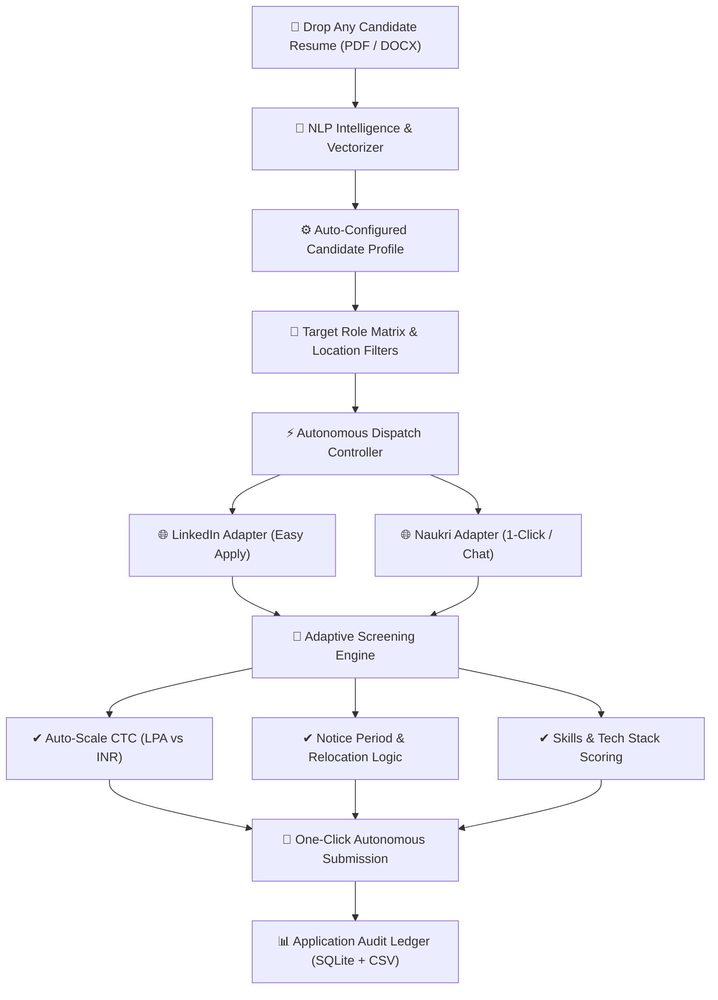

# 🚀 Raushonix AI — Autonomous Placement Engine

> **Next-Generation Autonomous Career Dispatcher & Intelligent Job Application Assistant**  
> *Engineered by Abhiraj Raushan*

[](https://www.python.org/)
[](https://playwright.dev/)
[](http://localhost:5000)
[](#-privacy--local-session-isolation)
[](#license)

---

## 🌟 Overview

**Raushonix AI** is a fully autonomous, local job placement engine designed to automate end-to-end applications across **LinkedIn (Easy Apply)** and **Naukri.com (1-Click & Chat Apply)**. 

Equipped with an **NLP Resume Parser**, **Intelligent Screening Question Engine**, and a **Real-Time Web Dashboard**, Raushonix AI dynamically tailors application questions (CTC, notice period, experience, relocation, tech stacks), matches candidate ATS scores, fast-skips previously applied postings, and logs every dispatch to a comprehensive Audit Ledger.

---

## 📸 Interactive Web Dashboard (`http://localhost:5000`)

```
+----------------------------------------------------------------------------------------------------+
| ⚡ Raushonix AI                                [ Radar Dispatch ] [ Audit Ledger ] [ Settings ]    |
|   Autonomous Placement Engine                   ● Naukri Connected  ● LinkedIn Connected           |
+----------------------------------------------------------------------------------------------------+
| [1] RESUME & PROFILE INTELLIGENCE              | [4] FAST SCREENING AUTO-ANSWERS                    |
|   ┌────────────────────────────────────────┐   |   Expected CTC (LPA): [ 8 ]  Current: [ 4 ]        |
|   |   📂 Drop PDF or DOCX Resume Here      |   |   Notice Period: [ 30 Days ] Relocation: [ Yes ]   |
|   |   Instant NLP extraction of skills     |   |   [ Save Search & Screening Parameters ]           |
|   └────────────────────────────────────────┘   +----------------------------------------------------+
|   Active: resume_v2.pdf · 2 Yrs Exp · 35 Skills| [5] AUTONOMOUS DISPATCH CONTROLLER                 |
+------------------------------------------------+   Channel: [ Naukri.com ] [ LinkedIn ] [ Unified ] |
| [2] HIRING CHANNEL AUTHENTICATION              |   Application Quota: ──●───────── [ 10 Jobs ]      |
|   [N] Naukri.com       [ Authenticated ✔ ]     |   [✔] Autonomous Mode  [ ] Dry Run Simulation      |
|   [in] LinkedIn        [ Authenticated ✔ ]     |   [ 🚀 LAUNCH AUTONOMOUS APPLY ]                   |
+------------------------------------------------+----------------------------------------------------+
| [3] REAL-TIME DIAGNOSTIC FEED                                                                       |
|   [15:08:07] ✔ [LINKEDIN] Applied: Zemoso Technologies — Senior Software Engineer (Match: 100%)    |
|   [15:09:28] ✔ [LINKEDIN] Applied: Luxoft — Full Stack Engineer (Java+React) (Match: 100%)          |
+----------------------------------------------------------------------------------------------------+
```

---

## 🏗️ Architecture & Operational Workflow



---

## 👥 Can Anyone Else Use This? (100% Plug-and-Play)

**YES! Raushonix AI is fully multi-user and privacy-agnostic.**

When anyone clones this repository:
1. **Zero Personal Data Leakage**: The repository contains **no personal resumes**, **no credentials**, **no session cookies**, and **no application history**.
2. **Drop Any Resume**: When a friend opens the Web Dashboard and uploads their own resume, the engine automatically extracts **their** name, skills, experience, and contact information.
3. **Isolated Browser Profiles**: When logging in to LinkedIn or Naukri, sessions and cookies are saved **locally on their machine only** (`data/chrome-profile-*`).
4. **Tailored Applications**: Job searches, ATS matching, and screening responses automatically adjust to the newly uploaded candidate's profile.

---

## 🚀 Quickstart Guide

### 1. Prerequisites
- **Python 3.10** or higher installed ([Download Python](https://www.python.org/downloads/))
- **Google Chrome** installed (or Chromium)

### 2. Clone the Repository
```bash
git clone https://github.com/Abhirajraushan/AI_Automation_tool.git
cd AI_Automation_tool
```

### 3. Install Dependencies
```bash
pip install -r requirements.txt
playwright install chromium
```

### 4. Launch the Web Dashboard
Double-click **`start_ui.bat`** or run:
```bash
python -u run_web.py
```
*Your browser will automatically open to:* **`http://localhost:5000`**

---

## 🛠️ How to Use (Step-by-Step)

### Step 1: Upload Your Resume
- In the Web Dashboard under **Resume & Profile Intelligence**, drag and drop your resume (`.pdf` or `.docx`).
- The NLP engine immediately parses your:
  - Technical skills & proficiencies
  - Total years of industry experience
  - Contact details (email, phone, location)
  - Target job requisitions (Backend, Full Stack, Cybersecurity, etc.)

### Step 2: Authenticate Channels (One-Time)
- Click **"Re-authenticate"** for **Naukri.com** or **LinkedIn Easy Apply**.
- A dedicated browser window will open.
- Log in to your account. Your authenticated session is encrypted and stored locally in isolated Chrome profiles.

### Step 3: Launch Autonomous Apply
- Select your target channel (**Naukri**, **LinkedIn**, or **Unified**).
- Set your quota slider (e.g. 5, 10, or 25 postings).
- Click **🚀 Launch Autonomous Apply**.
- Watch the live application stream in the **Diagnostic Feed**!

### Step 4: Audit Ledger & Analytics
- Navigate to the **Audit Ledger** tab to review:
  - Applied company names, positions, and locations
  - ATS match score percentages
  - Exact screening question answers submitted
  - Export audit trail to CSV anytime

---

## 💻 CLI Commands (For Developers & Power Users)

Prefer the terminal? Run any operation directly via CLI:

```bash
# Run Naukri applications (Limit: 5, Auto mode)
python -m src.main run --site naukri --limit 5 --auto --no-ask

# Run LinkedIn applications (Limit: 5, Auto mode)
python -m src.main run --site linkedin --limit 5 --auto --no-ask

# Run dry-run simulation (scores jobs without submitting)
python -m src.main run --site linkedin --dry-run

# Re-authenticate hiring channels
python -m src.main login --site naukri
python -m src.main login --site linkedin

# Standalone referral outreach to recruiters on LinkedIn
python -m src.main outreach --pending 1
```

---

## 🛡️ Privacy & Local Session Isolation

Raushonix AI is architected with strict privacy guarantees:
- **Zero Cloud Tracking**: All browser automation, form parsing, and database records run **strictly on your localhost**.
- **Airtight `.gitignore`**: All resumes (`*.pdf`, `*.docx`), persistent Chrome profiles (`data/chrome-profile-*`), local application history (`data/applications.db`), and API keys (`config/.env`) are strictly excluded from git tracking.
- **Independent Session Profiles**: Naukri and LinkedIn sessions run in separate Chrome sandbox directories so multiple accounts never cross-contaminate.

---

## 📁 Repository Structure

```
├── run_web.py                 # Web Dashboard Server (Aiohttp + WebSockets on port 5000)
├── start_ui.bat               # 1-Click Windows Launcher for Web Dashboard
├── requirements.txt           # Python dependencies (Playwright, Aiohttp, PyPDF, etc.)
├── .gitignore                 # Strict privacy exclusion filters
├── config/
│   ├── profile.example.yaml   # Template candidate profile config
│   ├── search.yaml            # Job search matrix, keyword queries, and daily limits
│   ├── outreach.yaml          # LinkedIn networking & referral templates
│   └── .env.example           # Environment template (Gemini / OpenAI API keys)
├── src/
│   ├── config.py              # Configuration loader & fallback manager
│   ├── runner.py              # Core application orchestrator & quota manager
│   ├── core/
│   │   ├── forms.py           # Universal form scanner (captures constraints, min/max, radio)
│   │   ├── review.py          # Adaptive screening response engine & precedence rules
│   │   ├── matcher.py         # ATS resume-to-job description scoring engine
│   │   └── browser.py         # Chromium session controller & human pacing
│   ├── sites/
│   │   ├── linkedin.py        # LinkedIn Easy Apply automation adapter
│   │   └── naukri.py          # Naukri 1-Click & Chat application adapter
│   └── web/                   # Web application server, REST APIs, and UI assets
└── data/                      # Local-only folder (Resumes, Sessions, SQLite DB) [IGNORED]
```

---

## 🤝 Contributing

Contributions, feature requests, and suggestions are welcome!
1. Fork the Project
2. Create your Feature Branch (`git checkout -b feature/AmazingFeature`)
3. Commit your Changes (`git commit -m 'Add AmazingFeature'`)
4. Push to the Branch (`git push origin feature/AmazingFeature`)
5. Open a Pull Request

---

## 📄 License

Distributed under the **MIT License**. See `LICENSE` for more information.

---

<p align="center">
  <b>Raushonix AI</b> — Engineered with precision by <b>Abhiraj Raushan</b>
</p>
