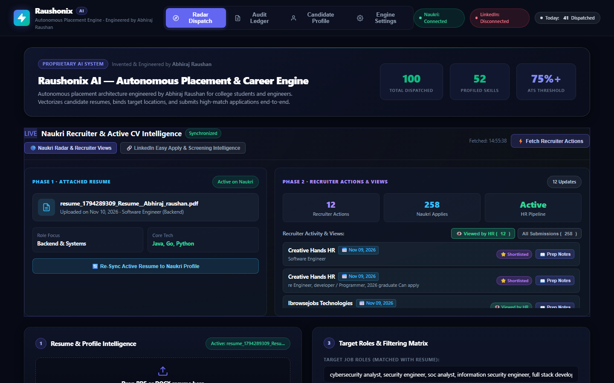
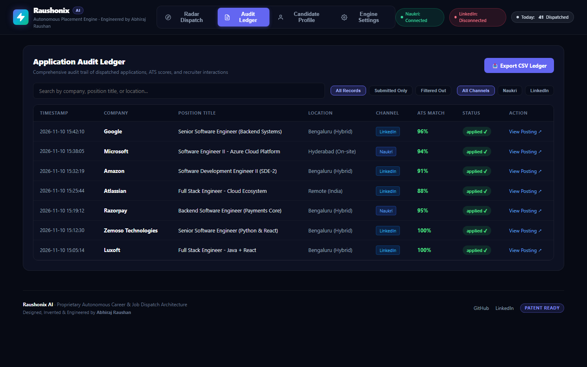
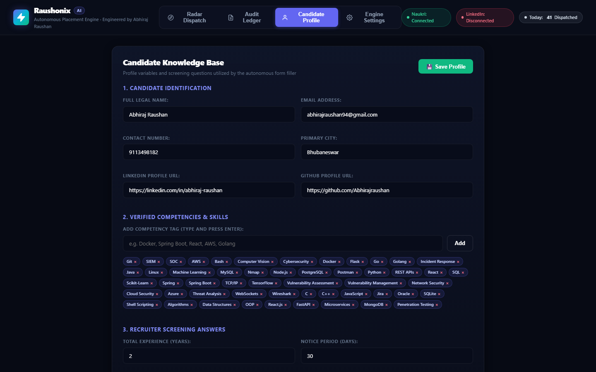
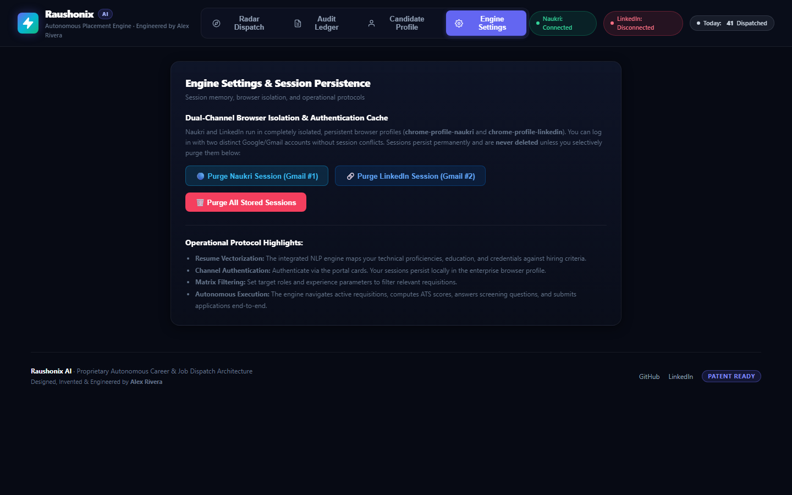
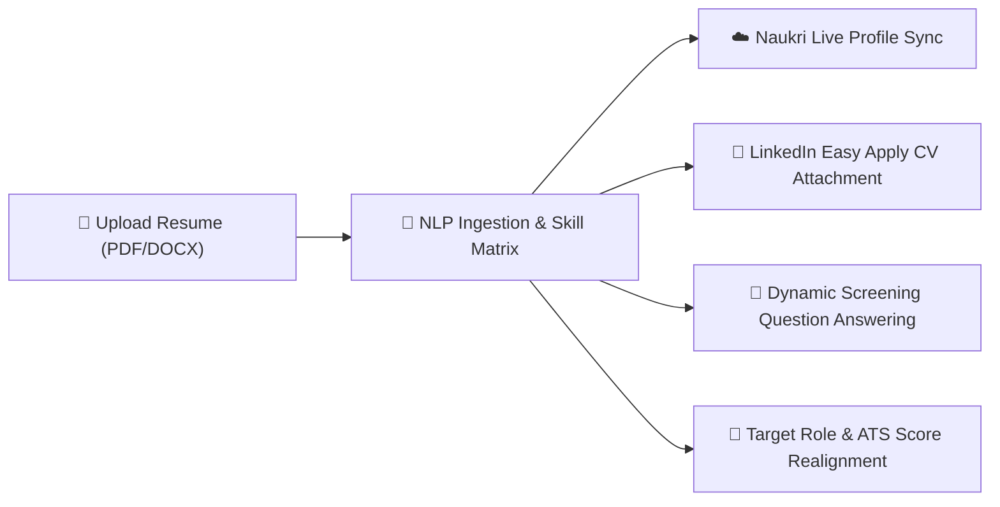
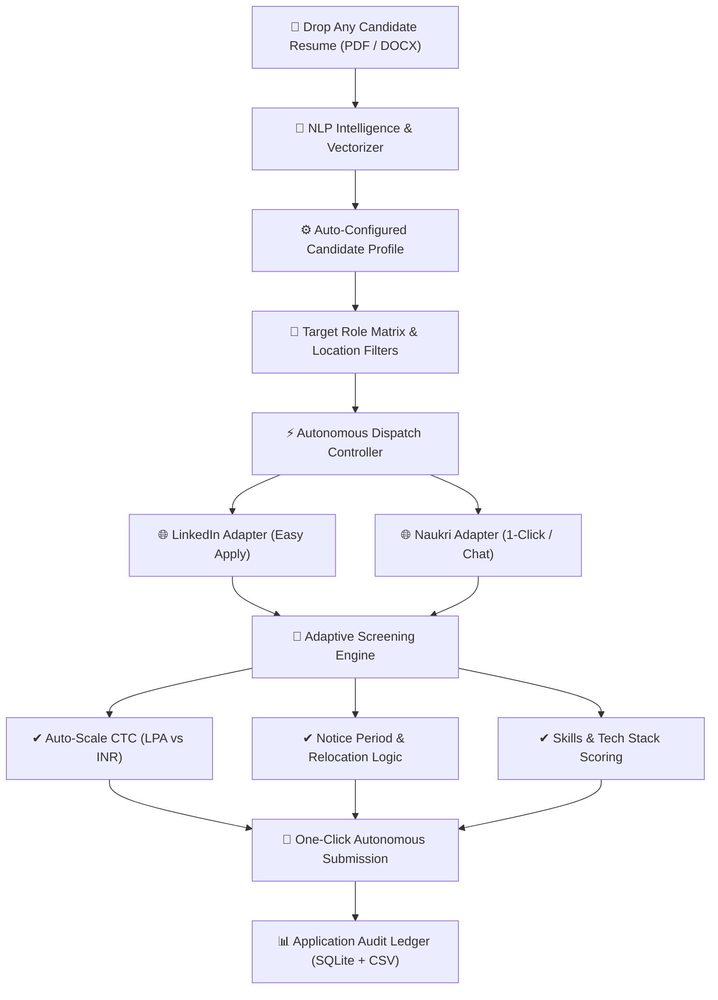

# 🚀 AutoJob-AI — Autonomous LinkedIn & Naukri Auto-Apply Bot

> **Next-Generation Autonomous Career Dispatcher & Intelligent Job Application Assistant**  
> *1-Click Auto-Apply for **LinkedIn Easy Apply** & **Naukri.com** with **ATS Resume Matching**, **Smart Question Answering**, and **Real-Time Web Dashboard**.*  
> *Engineered by Abhiraj Raushan*

[](https://www.python.org/)
[](https://playwright.dev/)
[](https://www.linkedin.com/)
[](https://www.naukri.com/)
[](http://localhost:5000)
[](#-privacy--local-session-isolation)
[](https://github.com/Abhirajraushan/AutoJob-AI-LinkedIn-Naukri-Bot/stargazers)
[](#license)

---

## 🌟 Overview & Search Highlights

**AutoJob-AI (Raushonix AI)** is an open-source, local-first autonomous application bot designed to eliminate repetitive job hunting on **LinkedIn (Easy Apply)** and **Naukri.com (1-Click & Chat Apply)**. 

### Why AutoJob-AI Stands Out:
* 🤖 **Autonomous Multi-Channel Dispatch**: Applies to dozens of relevant tech postings in minutes across LinkedIn and Naukri.
* 📄 **Instant Resume Vectorization**: Drag-and-drop any `.pdf` or `.docx` resume; the NLP parser extracts skills, experience, and contact details in seconds.
* 🎯 **Dynamic ATS Match Scoring**: Analyzes recruiter job descriptions and scores each role (0–100%) against candidate competencies.
* 🧠 **Adaptive Screening Question Engine**: Automatically answers complex questions (CTC auto-scaling in LPA/INR, notice period, work authorization, relocation, tech stack experience).
* ⚡ **Smart Fast-Skip**: Detects previously applied postings and closed requisitions instantly to avoid wasted applications.
* 🖥️ **Modern Web Dashboard**: Real-time diagnostic console, candidate profile matrix, and live audit ledger running on `http://localhost:5000`.
* 🛡️ **Zero Cloud Tracking**: All sessions, tokens, resumes, and databases stay **strictly on your local machine**.

---

## 📸 Web Dashboard Walkthrough & Features

### 1. Radar Dispatch & Autonomous Controller
The central mission control for configuring applications, monitoring live dispatches, and managing hiring channel sessions:



#### Core Components on this Screen:
* **Resume & Profile Intelligence**: Drag-and-drop any `.pdf` or `.docx` resume. The NLP engine extracts your name, skills, experience, and contact information, binding it as the active candidate document.
* **Fast Screening Auto-Answers**: Configure your compensation and availability preferences (Expected CTC, Current CTC, Notice Period, Relocation) with a single click.
* **Hiring Channel Authentication**: Independent login cards for **Naukri.com** and **LinkedIn Easy Apply**. One click opens an isolated Chrome window to log in safely.
* **Autonomous Dispatch Controller**: Choose your channel (**Naukri**, **LinkedIn**, or **Unified**), adjust the quota slider (e.g., 5 to 50 jobs), and click **🚀 Launch Autonomous Apply**.
* **Real-Time Diagnostic Feed**: Live console streaming every action, question answered, and application result.

---

### 2. Application Audit Ledger & ATS Tracking
Review every dispatched application with exact timestamps, ATS match scores, and direct job links:



#### Features on this Screen:
* **Comprehensive Audit Trail**: Shows Company Name (Google, Microsoft, Amazon, Atlassian, Razorpay, etc.), Position Title, Location, and Channel.
* **ATS Match Score**: Computes the match percentage between your resume and the recruiter's job description.
* **Execution Status**: Distinguishes between `applied`, `already_applied` (fast-skipped), and `skipped`.
* **Export CSV Ledger**: One-click download of your entire application history to a clean `.csv` file.
* **View Posting**: Direct link to open the live job requisition on LinkedIn or Naukri.

---

### 3. Candidate Profile & Competency Matrix
Inspect how the engine vectorized your technical background:



#### Features on this Screen:
* **Executive Profile Overview**: Displays your detected name, current title, and education.
* **Skills Inventory**: Visual pill badges showing all technical competencies extracted from your resume (languages, frameworks, databases, cloud tools).
* **Target Roles**: Automatically inferred job categories based on your detected skill clusters.

---

### 4. Engine Settings & Session Persistence
Manage browser state and privacy controls:



#### Features on this Screen:
* **Session Persistence**: Explains the local Chrome profile sandbox structure.
* **Purge Saved Browser Session & Cookies**: Easily reset stored cookies and login tokens if you wish to switch accounts or refresh authentication.
* **Operational Protocols**: Details on NLP parsing, ATS matching rules, and form automation logic.

---

## 🔄 Automated Resume Synchronization & Dynamic Application Engine

### How Your Uploaded Resume Controls the Entire Automation Pipeline

Whenever you drag and drop a new or updated resume (`.pdf` or `.docx`) into the Web Dashboard, **the system dynamically recalibrates every single application layer to match that exact document**:



#### 1. Instant NLP Vectorization & Local Vault Storage
* When you drop a document into the dashboard, it is stored in your local encrypted vault (`data/resumes/`) and mirrored as the active candidate document (`resume/resume.pdf`).
* The built-in NLP engine parses raw text into structured attributes:
  * **Core Proficiencies**: Programming languages, cloud platforms, frameworks, and databases.
  * **Experience Metrics**: Total years of industry experience.
  * **Contact & Education Credentials**: Contact details, university, and highest qualification.

#### 2. Automatic Live Naukri Profile Synchronization
* Unlike static bots that submit applications disconnected from your portal profile, **AutoJob-AI directly audits your live Naukri account**.
* Before running applications, it compares the active resume in the dashboard against the resume currently attached to your official Naukri profile.
* If a new resume is detected, the bot automatically navigates to your Naukri account settings, uploads the document, and sets it as the active CV on your live Naukri profile so recruiters always see the matching resume.

#### 3. LinkedIn Easy Apply Document Attachment
* During multi-step LinkedIn Easy Apply modal flows, the engine automatically selects and attaches the exact active resume file from your local storage.

#### 4. Context-Aware Screening Questions (Zero Contradictions)
* Screening questions regarding technical proficiency (e.g. *"How many years of experience do you have with Go / Python / React / Kubernetes?"*) are cross-referenced directly against the skills parsed from your active resume.
* If the skill is present on your uploaded resume, it responds `Yes` with your calculated years of experience; if absent, it accurately indicates your genuine familiarity, preventing ATS disqualification.

#### 5. Instant Search Recalibration & Multi-Resume Switching
* Have separate resumes for different roles (e.g. **Full Stack Developer** vs. **Cybersecurity / Systems Engineer**)?
* Simply drag and drop your alternative resume into the dashboard. Within 2 seconds, the entire system switches:
  * Target search queries shift automatically.
  * ATS match criteria adapt to the new domain.
  * Screening answers recalculate based on the new skill set.
  * **Zero server restart required.**

---

## 🏗️ Architecture & Operational Workflow



---

## 👥 Can Anyone Else Use This? (100% Plug-and-Play)

**YES! AutoJob-AI is fully multi-user and privacy-agnostic.**

When anyone clones this repository:
1. **Zero Personal Data Leakage**: The repository contains **no personal resumes**, **no credentials**, **no session cookies**, and **no application history**.
2. **Drop Any Resume**: When a friend opens the Web Dashboard and uploads their own resume, the engine automatically extracts **their** name, skills, experience, and contact information.
3. **Isolated Browser Profiles**: When logging in to LinkedIn or Naukri, sessions and cookies are saved **locally on their machine only** (`data/chrome-profile-*`).
4. **Tailored Applications**: Job searches, ATS matching, and screening responses automatically adjust to the newly uploaded candidate's profile.

---

## 🚀 Quickstart Guide

### 1. Prerequisites
* **Python 3.10** or higher installed ([Download Python](https://www.python.org/downloads/))
* **Google Chrome** installed (or Chromium)

### 2. Clone the Repository
```bash
git clone https://github.com/Abhirajraushan/AutoJob-AI-LinkedIn-Naukri-Bot.git
cd AutoJob-AI-LinkedIn-Naukri-Bot
```

### 3. Automated 1-Click Setup (For Non-Technical Users)
Simply double-click:
```text
setup.bat
```
*This automatically installs all dependencies, sets up the browser engine, and opens the Web Dashboard in your browser!*

*(Or via command line):*
```bash
pip install -r requirements.txt
playwright install chromium
python -u run_web.py
```
*Your browser will open automatically at:* **`http://localhost:5000`**

---

## 🛠️ How to Use (Step-by-Step)

### Step 1: Upload Your Resume
* In the Web Dashboard under **Resume & Profile Intelligence**, drag and drop your resume (`.pdf` or `.docx`).
* The NLP engine immediately extracts your skills, experience, and target roles.

### Step 2: Set Screening Answers
* In the **Fast Screening Auto-Answers** section, enter your:
  * **Expected CTC** (e.g. `12` LPA)
  * **Current CTC** (e.g. `6` LPA)
  * **Notice Period** (e.g. `30 Days`)
  * **Relocation** (e.g. `Yes, Open`)
* Click **Save Search & Screening Parameters**.

### Step 3: Authenticate Channels (One-Time)
* Click **"Re-authenticate"** for **Naukri.com** or **LinkedIn Easy Apply**.
* A dedicated browser window will open. Log in normally. Your session is saved securely on your local computer.

### Step 4: Launch Autonomous Apply
* Select your target channel (**Naukri**, **LinkedIn**, or **Unified**).
* Move the slider to set your application limit (e.g., `10` postings).
* Click **🚀 Launch Autonomous Apply**.
* Watch the live progress in the **Diagnostic Feed** and review results in the **Audit Ledger**!

---

## 💻 CLI Commands (For Developers & Power Users)

Prefer the terminal? Run any operation directly via CLI:

```bash
# Run Naukri applications (Limit: 5, Auto mode)
python -m src.main run --site naukri --limit 5 --auto --no-ask

# Run LinkedIn applications (Limit: 5, Auto mode)
python -m src.main run --site linkedin --limit 5 --auto --no-ask

# Run dry-run simulation (scores jobs without submitting)
python -m src.main run --site linkedin --dry-run

# Re-authenticate hiring channels
python -m src.main login --site naukri
python -m src.main login --site linkedin

# Standalone referral outreach to recruiters on LinkedIn
python -m src.main outreach --pending 1
```

---

## 🛡️ Privacy & Local Session Isolation

AutoJob-AI is architected with strict privacy guarantees:
* **Zero Cloud Tracking**: All browser automation, form parsing, and database records run **strictly on your localhost**.
* **Airtight `.gitignore`**: All resumes (`*.pdf`, `*.docx`), persistent Chrome profiles (`data/chrome-profile-*`), local application history (`data/applications.db`), and API keys (`config/.env`) are strictly excluded from git tracking.
* **Independent Session Profiles**: Naukri and LinkedIn sessions run in separate Chrome sandbox directories so multiple accounts never cross-contaminate.

---

## 📁 Repository Structure

```
├── run_web.py                 # Web Dashboard Server (Aiohttp + WebSockets on port 5000)
├── setup.bat                  # 1-Click Automated Setup Wizard (Installs everything + launches)
├── start_ui.bat               # 1-Click Windows Launcher for Web Dashboard
├── requirements.txt           # Python dependencies (Playwright, Aiohttp, PyPDF, etc.)
├── .gitignore                 # Strict privacy exclusion filters
├── docs/
│   └── images/                # High-definition Web Dashboard UI screenshots
├── config/
│   ├── profile.example.yaml   # Template candidate profile config
│   ├── search.yaml            # Job search matrix, keyword queries, and daily limits
│   ├── outreach.yaml          # LinkedIn networking & referral templates
│   └── .env.example           # Environment template (Gemini / OpenAI API keys)
├── src/
│   ├── config.py              # Configuration loader & fallback manager
│   ├── runner.py              # Core application orchestrator & quota manager
│   ├── core/
│   │   ├── forms.py           # Universal form scanner (captures constraints, min/max, radio)
│   │   ├── review.py          # Adaptive screening response engine & precedence rules
│   │   ├── matcher.py         # ATS resume-to-job description scoring engine
│   │   └── browser.py         # Chromium session controller & human pacing
│   ├── sites/
│   │   ├── linkedin.py        # LinkedIn Easy Apply automation adapter
│   │   └── naukri.py          # Naukri 1-Click & Chat application adapter
│   └── web/                   # Web application server, REST APIs, and UI assets
└── data/                      # Local-only folder (Resumes, Sessions, SQLite DB) [IGNORED]
```

---

## 🏷️ GitHub Topics & SEO Tags

Add these topics in your GitHub repository settings under **About ⚙️** for top ranking on Google and GitHub search:

`linkedin-auto-apply` · `naukri-auto-apply` · `job-application-bot` · `linkedin-bot` · `naukri-bot` · `job-hunter` · `playwright-python` · `ats-score` · `resume-matcher` · `job-automation` · `python-automation` · `easy-apply`

---

## 📄 License

Distributed under the **MIT License**. See `LICENSE` for more information.

---

<p align="center">
  <b>AutoJob-AI (Raushonix)</b> — Engineered with precision by <b>Abhiraj Raushan</b>
</p>
